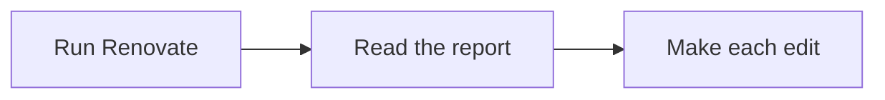

# Documentation

This site is built with [Zensical](https://zensical.org). The configuration is in
[`zensical.toml`](https://github.com/jbsilva/renovate-apply/blob/main/zensical.toml) at the
repository root, and the pages are Markdown under `docs/`.

## Preview

```bash
uv run poe docs
```

The site is served at <http://localhost:8000> and reloads on every change. For another port:

```bash
uv run poe docs -a localhost:8001
```

## Build

```bash
uv run poe docs-build
```

The output goes to `site/`, which is gitignored. It is a build artifact and is never committed.

The build reports broken internal links as warnings. Read them; a link to a page that does not exist
still builds a site, just a broken one.

## Publishing

[`.github/workflows/docs.yml`][docs-workflow] builds and deploys to GitHub Pages on pushes to `main`
that touch the docs:

```bash
uv run --only-group docs --locked --no-build zensical build --clean
```

`--only-group docs` because the build needs Zensical and nothing else. `--locked` fails on a drifted
`uv.lock`. `--clean` wipes the output first. The published site is at
<https://jbsilva.github.io/renovate-apply/>.

## Adding a page

Create the Markdown file under `docs/` and add it to the `nav` table in `zensical.toml`. A page that
is not in `nav` is not in the site.

Each page starts with front matter setting an icon, then one H1, then a short intro:

```markdown
---
icon: lucide/book-open-text
---

# Page title

One to three sentences saying what the page covers.
```

Icons come from [Lucide](https://lucide.dev), as `lucide/<name>`.

## Syntax worth knowing

An admonition is a fenced callout. The body is indented four spaces after a blank line:

```markdown
!!! tip

    The body of the tip.
```

`note`, `tip` and `warning` are the three used here.

Content tabs group real alternatives:

```markdown
=== "uv"

    Steps for uv.

=== "pipx"

    Steps for pipx.
```

Mermaid diagrams render from a fenced block:

````markdown

````

## Style

- Hard-wrap at 100 columns. `mdformat` does it for you as a hook.
- Sentence-case headings. One H1 per page.
- Indent nested list items four spaces.
- Link between pages with relative `.md` paths, such as [Testing](testing.md) or
    [Installation](../getting-started/installation.md). Add a `#kebab-anchor` for a heading.
- Link to source with an absolute GitHub URL on `main`, such as
    [`replace.py`](https://github.com/jbsilva/renovate-apply/blob/main/src/renovate_apply/replace.py).
- Write plainly. Short sentences. Say the thing, then stop.

!!! warning

    The docs describe behavior, and behavior changes. When you change a flag, a default, or what the
    tool holds back, grep `docs/` for it in the same commit. Nothing checks this automatically yet.

[docs-workflow]: https://github.com/jbsilva/renovate-apply/blob/main/.github/workflows/docs.yml
