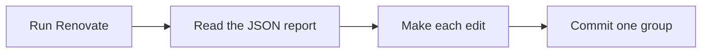

# How it works

A run is four steps: scan, read, edit, commit.



Each step lives in its own module, so a change in Renovate's output breaks one place and not three.

| Module         | What it does                                                                 |
| -------------- | ---------------------------------------------------------------------------- |
| `scan.py`      | Runs Renovate and hands back the parsed report.                              |
| `report.py`    | Flattens the report into `Update` objects, holds some back, groups the rest. |
| `replace.py`   | Turns one update into one text replacement.                                  |
| `files.py`     | Reads and writes the package files.                                          |
| `lockfiles.py` | Runs `uv lock` when a manifest needs it.                                     |
| `messages.py`  | Writes the commit subject and body.                                          |
| `git.py`       | Checks the tree is clean, stages, commits.                                   |

## The short version

Renovate is told to scan the working copy and write a JSON report:

```bash
renovate --platform=local
```

with `RENOVATE_REPORT_TYPE=file`. The local platform needs no server, no clone and no credentials
beyond a read token. It also refuses to write anything, which is the whole reason this tool exists.

The report is nested: manager, then package file, then dependency, then the updates found for it.
Flattening that gives one `Update` per thing to change. Some are [held back](../usage/held-back.md).
The rest are grouped by the branch name Renovate put in the report, and each group becomes one
commit.

For each update the report carries the exact text the manager found in the file and a template for
writing that text again. Rendering the template and swapping it for the old text is the whole edit.
It is Renovate's own auto-replace, handed over as data rather than performed.

## Read on

- [Reading the report](report.md): what the report holds and how it is narrowed.
- [Making the edit](replacing.md): the replacement, and what happens when it does not fit.
- [Commits and lock files](commits.md): grouping, messages, and `uv.lock`.
